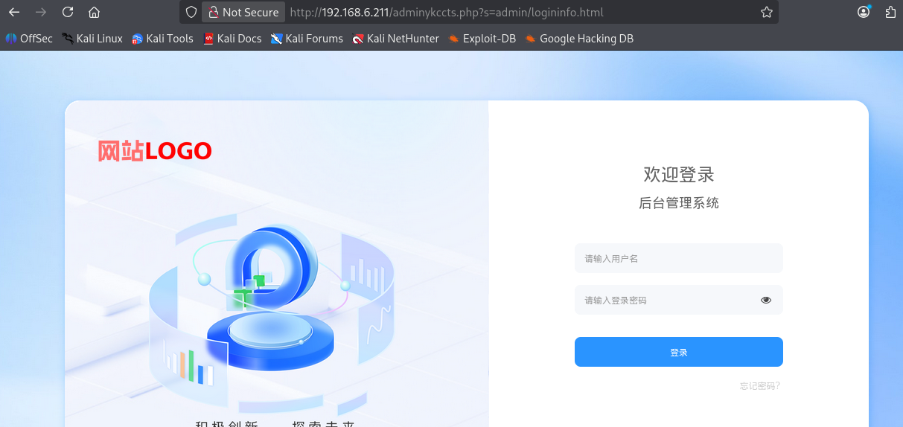

# ShopXO <= 6.9.2 contains a command injection vulnerability that can be exploited after administrator authentication.

The "Create Application" API endpoint in the ShopXO backend (Pluginsadmin::Save → PluginsAdminService::PluginsSave) fails to properly validate the `plugins` and `name` parameters. This vulnerability allows for path traversal and PHP code injection, ultimately leading to remote code execution (RCE).

If you use the BT (Baota) installation method recommended by ShopXO, please enable "dangerous" functions—such as `eval`—within your PHP configuration.


How to Use the Script

```
python shopox-RCE.py -u http://192.168.6.211 --admin-entry adminykccts.php -a admin -p 123456 --mode shell
```
adminykccts.php is the path to the administrator backend.


